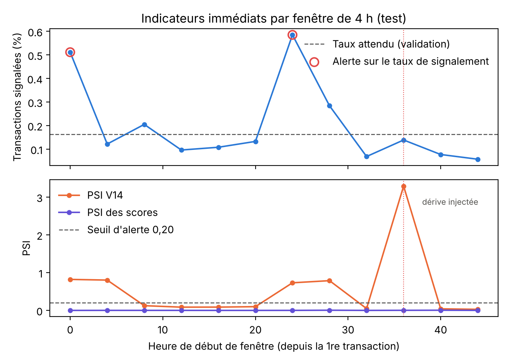

# Plan de surveillance après déploiement

Ce document couvre la partie X du sujet. La simulation qui l'accompagne (`scripts/monitoring_simulation.py`, résultats dans `monitoring_simulation.csv`) rejoue le jeu de test dans l'ordre chronologique, par fenêtres de 4 heures, comme s'il s'agissait d'un flux de production.

## 1. Deux dérives à ne pas confondre

La **dérive des données** (data drift) désigne un changement de distribution des variables d'entrée : les transactions ne ressemblent plus à celles de l'entraînement. Elle se mesure tout de suite, sans connaître l'issue des transactions.

La **dérive de concept** (concept drift) désigne un changement de la relation entre les variables et la fraude. Les fraudeurs changent de méthode : une transaction qui avait l'air normale ne l'est plus, ou l'inverse. Elle ne se voit qu'avec les labels, c'est-à-dire une fois les fraudes confirmées par enquête, réclamation du client ou rétrofacturation. Ces labels arrivent avec des semaines, parfois des mois de retard.

Une dérive des données n'entraîne pas forcément une baisse de performance, et une dérive de concept peut survenir sans aucun changement visible des entrées. Il faut donc surveiller les deux.

## 2. Indicateurs et délais

| Indicateur | Disponible | Méthode | Seuil d'alerte proposé |
|---|---|---|---|
| Volume de transactions scorées | immédiatement | compteur par fenêtre | écart de plus de 3 écarts types par rapport à la même heure des semaines précédentes |
| Taux de rejet par le contrat de données | immédiatement | part des requêtes rejetées, par motif | plus de 0,5 % sur une heure : incident probable en amont |
| Taux de transactions signalées | immédiatement | part des scores au-dessus du seuil | hors de la bande attendue (voir section 3) |
| Distribution des variables d'entrée | immédiatement | PSI par variable par rapport à une référence de la même tranche horaire | PSI supérieur à 0,20 sur une variable importante (V17, V14, V10) |
| Part de transactions hors domaine | immédiatement | alerte de domaine de `range_alerts` | plus de 1 % sur une heure |
| Distribution des scores | immédiatement | PSI des probabilités | supérieur à 0,10, mais voir la limite en section 3 |
| Latence P95 et P99, disponibilité | immédiatement | métriques du service | P95 au-dessus de 50 ms ou disponibilité sous 99,9 % |
| Précision des alertes | sous quelques jours | issue des alertes traitées par les analystes | sous 0,70 sur 7 jours glissants |
| Rappel, taux de faux négatifs | sous plusieurs semaines | fraudes confirmées non signalées (réclamations, rétrofacturations) | rappel mensuel sous 0,70 |
| Taux de faux positifs | sous quelques jours | alertes classées légitimes par les analystes, rapportées au volume | au-dessus de 0,1 % |
| Performance par segment | sous plusieurs semaines | voir la note d'audit des biais | écart entre segments supérieur à la limite fixée |

La précision s'obtient vite, parce que chaque alerte est examinée par un analyste. Le rappel, lui, est lent et toujours incomplet : une fraude non signalée n'est découverte que si le client s'en aperçoit et la conteste. Le rappel mesuré en production sera donc optimiste, et il faut le présenter comme tel.

## 3. Ce que la simulation m'a appris

Le taux de signalement attendu, mesuré sur la validation, est de 0,162 %. Sur les 12 fenêtres du test, deux déclenchent une alerte sur ce taux : de 0 h à 4 h (0,51 %) et de 24 h à 28 h (0,59 %). Ce sont les deux nuits. Les transactions y sont trois fois moins nombreuses et la part de fraude y est plus forte : 9 fraudes sur 1 955 transactions la première nuit, 13 sur 1 880 la seconde. Ce n'est pas une panne mais un rythme. Une alerte fondée sur une moyenne globale sonnerait donc chaque nuit, et l'équipe finirait par l'ignorer. La référence doit être calculée par tranche horaire, et idéalement par jour de la semaine.

Le même phénomène touche les variables : le PSI de V14 dépasse 0,7 pendant les deux nuits, sans aucune intervention. L'écart naturel entre les deux jours du jeu (11 variables au-delà de 0,20) va dans le même sens. Le seuil de 0,20 couramment cité ne convient pas tel quel à ces données. Il faudrait l'étalonner sur plusieurs semaines d'historique.

J'ai ensuite injecté une dérive artificielle dans la fenêtre de 36 h à 40 h, en déplaçant V14 de 1,5 écart type. Le PSI de V14 bondit à 3,29 et l'alerte se déclenche nettement. En revanche, ni le taux de signalement (0,14 %, dans la norme) ni le PSI des scores (0,002) ne réagissent. L'arbre ne produit que quelques valeurs de probabilité, et un déplacement de V14 qui ne fait franchir aucune frontière de feuille reste invisible en sortie. **Surveiller uniquement les scores ne suffit pas : il faut surveiller les entrées, au moins les variables les plus importantes du modèle.**

## 4. Que faire quand une alerte se déclenche

| Alerte | Première réaction | Si elle persiste |
|---|---|---|
| Hausse du taux de rejet | vérifier le flux amont (format, version de l'émetteur) | basculer sur les règles de repli et ouvrir un incident |
| Dérive des entrées sans baisse de précision | analyser les variables concernées, vérifier qu'il ne s'agit pas d'un effet de calendrier | enrichir la référence ou planifier un réentraînement |
| Hausse du taux de signalement | contrôler un échantillon d'alertes avec les analystes | ajuster le seuil sur des données récentes labellisées, avec validation métier |
| Baisse de la précision ou du rappel confirmée par les labels | dérive de concept probable | réentraîner sur des données récentes, requalifier avec les mêmes tests, comparer à la baseline avant de remplacer le modèle |
| Latence dégradée | vérifier la charge et l'infrastructure | augmenter la capacité, ou dégrader proprement vers les règles de repli |

Un réentraînement n'est jamais automatique. La nouvelle version passe par la même chaîne que la version actuelle : tests, comparaison à la baseline, décision tracée.

## 5. Mise en œuvre

Pour le prototype, les scripts produisent des fichiers CSV et des graphiques, et les alertes sont simulées. En production, le service exposerait ses compteurs (volume, rejets, signalements, latence, histogrammes de scores et de variables) au format Prometheus. Grafana afficherait les tableaux de bord et déclencherait les alertes, et un traitement quotidien calculerait les PSI et rapprocherait les labels arrivés entre-temps. Ces outils ne sont pas indispensables au prototype : la logique de calcul est déjà dans `app/monitoring.py` et testée.
