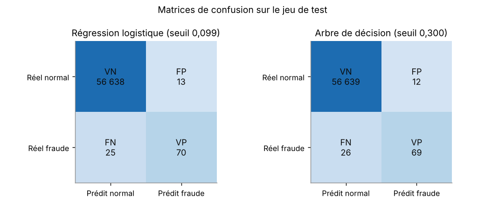
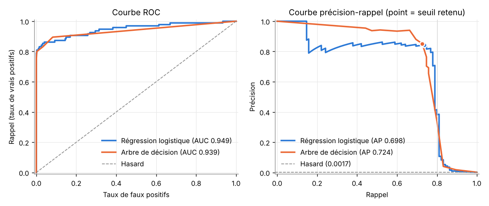
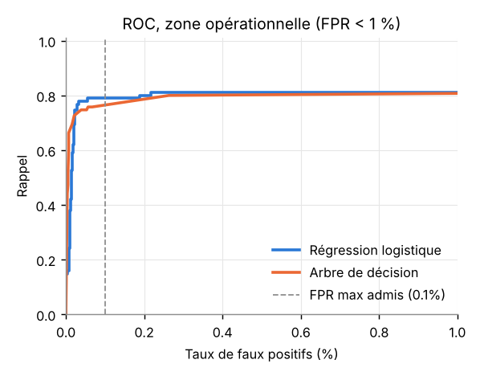
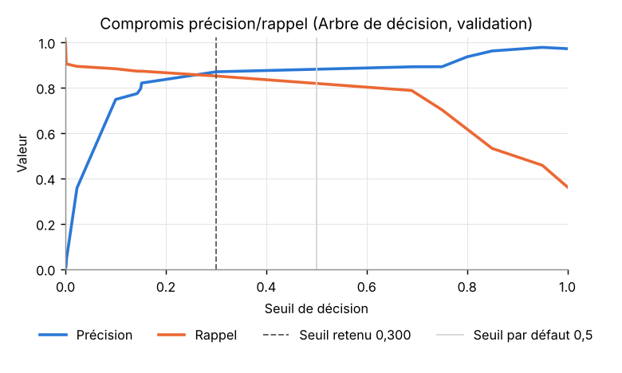
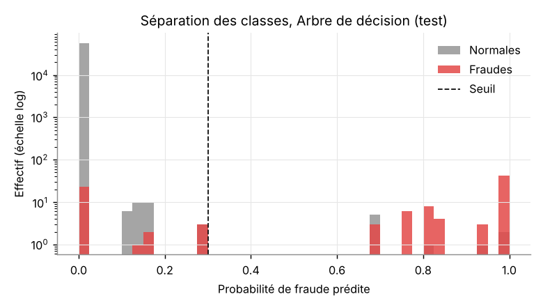

# Rapport d'évaluation du modèle

Ce rapport couvre la partie III du sujet : mesure des performances, comparaison de deux modèles légers et analyse des erreurs de classification. Tous les chiffres proviennent de `scripts/run_experiments.py` (sortie complète dans `run_experiments_output.txt` et `experiment_log.json`).

## 1. Données utilisées

Le fichier Kaggle contient 284 807 transactions, dont 492 fraudes. Avant toute chose, j'ai retiré 1 081 lignes strictement identiques à une autre ligne, parmi lesquelles 19 fraudes. Ce nettoyage n'est pas un détail : une transaction présente à la fois dans l'entraînement et dans le test serait « reconnue » par le modèle plutôt que réellement détectée, ce qui gonflerait les résultats. Il reste 283 726 transactions et 473 fraudes, soit un taux de fraude de 0,167 %.

La partition est stratifiée et fixée par la graine 42 :

| Jeu | Transactions | Fraudes | Taux de fraude |
|---|---:|---:|---:|
| Entraînement (60 %) | 170 235 | 284 | 0,167 % |
| Validation (20 %) | 56 745 | 94 | 0,166 % |
| Test (20 %) | 56 746 | 95 | 0,167 % |

Avec 95 fraudes seulement dans le jeu de test, chaque fraude manquée fait perdre un peu plus d'un point de rappel. Il faut garder cet ordre de grandeur en tête pour lire tout ce qui suit.

## 2. Démarche

L'ordre des opérations a été imposé dans le code pour qu'aucune information du test ne remonte vers les choix de modélisation.

1. Le préprocesseur (log1p puis standardisation de `Amount`, standardisation de `Time` et de `V1` à `V28`) et le modèle forment un seul `Pipeline` scikit-learn, ajusté uniquement sur l'entraînement.
2. Pour chaque famille de modèle, une petite grille d'hyperparamètres est évaluée sur la validation, avec la PR-AUC comme critère.
3. Le seuil de décision est choisi sur la validation selon une règle écrite avant l'expérience : parmi les seuils qui donnent un rappel d'au moins 80 % et au plus 0,1 % de faux positifs, on prend celui qui offre la meilleure précision.
4. Le modèle final est désigné sur la validation et ce choix est enregistré sur disque avant que le jeu de test soit lu.
5. Le test sert une seule fois, pour mesurer les deux modèles déjà figés.

Un test automatisé (`test_t05_tuning_and_threshold_never_touch_test_set`) remplace le jeu de test par un objet qui lève une erreur au moindre accès, puis lance le réglage. Il passe, ce qui prouve que le réglage ne touche pas au test.

## 3. Réglage sur la validation

| | Régression logistique | Arbre de décision |
|---|---|---|
| Meilleurs hyperparamètres | C = 1, sans pondération des classes | profondeur 6, 20 observations minimum par feuille, sans pondération |
| PR-AUC en validation | 0,798 | 0,833 |
| Seuil retenu | 0,0995 | 0,300 |
| Rappel / précision / FPR au seuil | 0,809 / 0,776 / 0,039 % | 0,851 / 0,870 / 0,021 % |
| Contrainte de seuil tenue | oui | oui |

L'arbre de décision obtient la meilleure PR-AUC en validation : c'est lui qui est retenu comme modèle candidat. Les variantes pondérées (`class_weight = "balanced"`) ont toujours fait moins bien. En forçant le modèle à rattraper le déséquilibre, elles produisent beaucoup de fausses alertes, et le réglage du seuil compense déjà ce que la pondération était censée apporter.

## 4. Résultats sur le jeu de test

| Métrique | Régression logistique | Arbre de décision (retenu) | IC 95 % de l'arbre (bootstrap, 1 000 tirages) |
|---|---:|---:|---|
| PR-AUC (Average Precision) | 0,698 | **0,724** | 0,632 à 0,812 |
| ROC-AUC | 0,949 | 0,939 | |
| Précision | 0,843 | **0,852** | 0,769 à 0,923 |
| Rappel | 0,737 | **0,726** | 0,636 à 0,813 |
| F1 | 0,787 | 0,784 | |
| Taux de faux positifs (FPR) | 0,023 % | **0,021 %** | 0,011 % à 0,034 % |
| Taux de faux négatifs (FNR) | 26,3 % | 27,4 % | |
| Accuracy | 99,933 % | 99,933 % | |

| Arbre de décision, test | Prédit normal | Prédit fraude |
|---|---:|---:|
| Réel normal | VN = 56 639 | FP = 12 |
| Réel fraude | FN = 26 | VP = 69 |

Concrètement, sur près de 57 000 transactions, l'arbre bloque 12 paiements légitimes et laisse passer 26 fraudes sur 95. La régression logistique fait presque jeu égal : une fraude détectée en plus, une fausse alerte en plus. Les deux modèles sont statistiquement indiscernables sur ce test, les intervalles se recouvrent largement.

La courbe ROC flatte les deux modèles, avec des aires proches de 0,95. Elle compte les faux positifs en proportion de 56 651 transactions normales, si bien qu'un taux de 1 % paraît minuscule sur le graphique alors qu'il représenterait 566 clients bloqués à tort. La courbe précision-rappel est plus honnête ici : les deux modèles tiennent une précision supérieure à 0,8 jusqu'à environ 75 % de rappel, puis s'effondrent. Au-delà de ce point, chaque fraude supplémentaire coûte des dizaines, puis des centaines de fausses alertes.

En zoomant sur la zone qui compte pour la banque (FPR inférieur à 1 %), on voit que les deux modèles plafonnent autour de 80 % de rappel. Ce plafond est une propriété des données plus que du modèle : une partie des fraudes ressemble trait pour trait à des transactions normales dans l'espace des variables disponibles.

## 5. Pourquoi l'accuracy ne dit presque rien

Un « modèle » qui déclarerait toutes les transactions normales obtiendrait 99,833 % d'accuracy sur ce test, sans détecter une seule fraude. Mon arbre atteint 99,933 %. L'écart entre un outil inutile et un outil qui arrête près des trois quarts des fraudes tient donc dans le dixième de point. La raison est simple : l'accuracy est dominée par les 56 651 transactions normales, et les 95 fraudes y pèsent moins de 0,2 %. Le test unitaire `test_high_accuracy_can_hide_zero_recall` reproduit ce piège sur un exemple contrôlé. C'est pourquoi l'accuracy figure dans mes tableaux à titre informatif, sans jamais intervenir dans une décision.

## 6. Le seuil et ses compromis

Extrait de `threshold_sensitivity_validation.csv` (arbre, validation) :

| Seuil | Précision | Rappel | FPR | Fraudes détectées | Fausses alertes |
|---:|---:|---:|---:|---:|---:|
| 0,10 | 0,748 | 0,883 | 0,049 % | 83 | 28 |
| 0,30 (retenu) | 0,870 | 0,851 | 0,021 % | 80 | 12 |
| 0,50 (par défaut) | 0,892 | 0,787 | 0,016 % | 74 | 9 |
| 0,70 | 0,892 | 0,702 | 0,014 % | 66 | 8 |
| 0,90 | 0,977 | 0,457 | 0,002 % | 43 | 1 |

Garder le seuil par défaut de 0,5 aurait coûté 6 fraudes détectées pour économiser 3 fausses alertes. Descendre à 0,10 en rattraperait 3 de plus au prix de 16 fausses alertes supplémentaires. Le seuil de 0,30 se situe là où la courbe change de pente. Comme l'arbre n'a que 19 feuilles, ses probabilités ne prennent que quelques valeurs. Tous les seuils compris entre deux valeurs voisines donnent donc la même décision, ce qui explique les paliers de la courbe.

## 7. Analyse des erreurs

**Les faux négatifs.** Les 26 fraudes manquées par l'arbre ont des scores très bas : la moitié reçoit une probabilité inférieure à 0,0015 et les trois quarts une probabilité inférieure à 0,018. Elles ne sont donc pas « juste sous le seuil ». Le modèle les juge franchement normales, et aucun réglage raisonnable du seuil ne les récupérera. Il faudrait des informations que ce jeu n'a pas : historique du porteur, commerçant, pays, appareil.

Ces fraudes manquées portent surtout sur de petits montants (médiane de 3,78 €, contre 33,59 € pour les fraudes détectées). En valeur, l'arbre intercepte 10 080 € sur les 14 766 € de fraude du jeu de test, soit 68 %, alors qu'il n'arrête que 73 % des fraudes en nombre. La régression logistique n'intercepte que 62 % du montant. Les petits débits frauduleux servent souvent à tester une carte volée avant un achat plus important : les laisser passer n'est pas anodin, même si la perte directe est faible.

**Les faux positifs.** Les 12 transactions légitimes bloquées par l'arbre obtiennent des scores élevés (médiane 0,69) et portent sur de petits montants (médiane 5,50 €). Elles tombent dans les mêmes feuilles que des fraudes avérées. Côté client, un blocage sur un achat de quelques euros reste gênant, mais il se résout en général par une simple confirmation. Les faux positifs de la régression logistique concernent des montants plus élevés (médiane 90 €), donc plus irritants pour le client.

**Ce que le modèle regarde.** Les importances de l'arbre sont très concentrées : V17 pèse 70 % des décisions, V14 et V10 environ 11 % chacune, V26 5 % et `Time` 2 %. Le montant ne joue aucun rôle (importance nulle). Je ne cherche pas à donner un sens métier à V17 ou V14, ce sont des composantes PCA anonymisées. Deux constats restent néanmoins exploitables pour la qualification. D'une part, un modèle qui ignore totalement le montant ne peut pas prioriser les alertes à fort enjeu. D'autre part, l'usage de `Time` pose problème, car cette variable compte les secondes écoulées depuis le début du jeu Kaggle et n'a aucune signification stable en production. Ces deux points sont repris comme anomalies dans le rapport final.

## 8. Surapprentissage et généralisation

| PR-AUC | Entraînement | Validation | Test |
|---|---:|---:|---:|
| Régression logistique | 0,750 | 0,798 | 0,698 |
| Arbre de décision | 0,825 | 0,833 | 0,724 |

L'arbre ne montre pas de surapprentissage classique : il fait aussi bien en validation qu'en entraînement, ce que la profondeur limitée à 6 et les 20 observations minimum par feuille expliquent. La baisse sur le test vient plutôt de deux effets cumulés. Le premier est l'aléa d'échantillonnage : avec moins de 100 fraudes par jeu, quelques fraudes « difficiles » de plus ou de moins font bouger la PR-AUC de plusieurs points. Le second est un léger optimisme de la validation : comme le modèle et le seuil ont été choisis pour y être les meilleurs, la validation surestime mécaniquement la performance. Le rappel passe ainsi de 0,851 en validation à 0,726 en test, alors que le seuil n'a pas changé.

J'ai ajouté un contrôle hors temps, qui n'intervient dans aucune décision : entraînement sur les 60 % de transactions les plus anciennes, seuil sur les 20 % suivantes, test sur les 20 % les plus récentes. On obtient une PR-AUC de 0,699, un rappel de 0,743, une précision de 0,743 et un FPR de 0,034 %. La précision baisse nettement quand on prédit « l'avenir », ce qui est cohérent avec la dérive entre le premier et le second jour décrite dans le rapport de robustesse. Une partition aléatoire, même stratifiée, donne donc une image plus favorable que ce qu'on observerait en exploitation.

## 9. Confrontation aux critères d'acceptation

| Critère (fixé avant le test) | Seuil | Arbre | Verdict |
|---|---|---:|---|
| PR-AUC | au moins 0,70 | 0,724 | atteint, mais la borne basse de l'intervalle (0,63) est en dessous |
| Rappel | au moins 0,75 | 0,726 | **non atteint**, l'intervalle 0,64 à 0,81 contient le seuil |
| Précision | au moins 0,50 | 0,852 | atteint largement |
| FPR | au plus 0,1 % | 0,021 % | atteint largement |

Selon les règles du plan de test, un critère manqué mais situé dans son intervalle de confiance appelle une **investigation**, pas un rejet. Le modèle est très sobre en fausses alertes, et c'est sa force. Son point faible est le rappel : environ une fraude sur quatre lui échappe, et ce sont précisément celles qu'il ne voit pas du tout.
